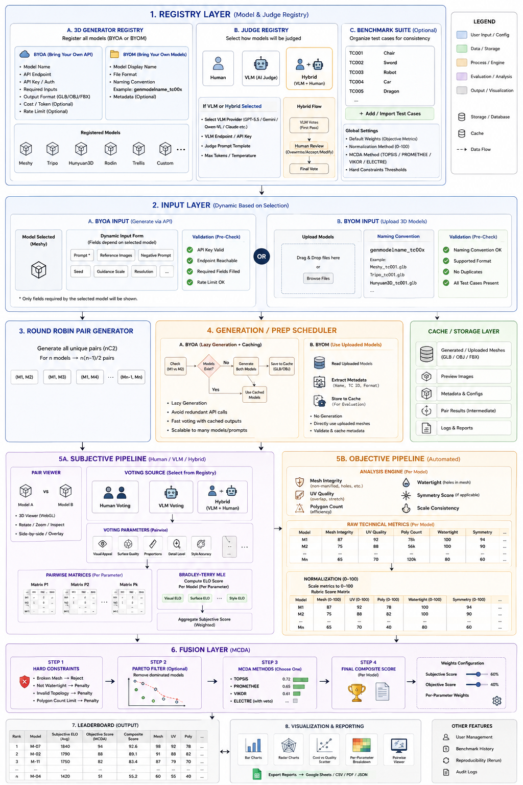

# 3D Model Evaluation Leaderboard

A comprehensive, state-of-the-art evaluation pipeline for benchmarking 3D generative models. The system combines **Subjective (Human/LLM in the loop)** and **Objective (Automated Analysis)** metrics, aggregating them through a **Multi-Criteria Decision Analysis (MCDA) Fusion Layer** to produce a definitive, multi-dimensional leaderboard.

---

## 🏗️ Architecture Overview

The system processes 3D model generation tasks through an 8-stage pipeline, maximizing efficiency via lazy generation and caching while ensuring rigorous evaluation.



---

## 🚀 Getting Started

### Prerequisites
- **Python 3.9+**
- Install the Python dependencies:
  ```bash
  pip install trimesh numpy scipy openpyxl
  ```
- *Optional:* `pip install pymeshlab` — only needed to regenerate objective mesh
  metrics from scratch. The pipeline runs fine on the cached metrics without it.

### Run the whole thing (one command)
From the project root:
```bash
cd "/Users/intern/Desktop/3d/3D-model-evaluation-leaderboard-main"
python3 main.py
```
This runs the full pipeline — **Layer 2 input validation → Layer 3 matchups →
Layer 4/5 scheduling + metric caching** — then opens the **Setup Studio** in your
browser, starting on the **Welcome** page (pick BYOM + the judge).

### The web UIs
While the server is running, open:
| Page | URL |
| :--- | :--- |
| **Entry — Setup Studio** (starts on Welcome) | `http://127.0.0.1:8000/` |
| **Voting** (blind A/B pair viewer) | `http://127.0.0.1:8000/Layer 6A - Subjective Pipeline/preview.html` |
| **Leaderboard** | `http://127.0.0.1:8000/Layer 8 - Leaderboard/leaderboard.html` |

The root URL redirects to the wizard; every step reads live data from the running
server (registry, validation, pairs, results).

### Useful commands
| Command | What it does |
| :--- | :--- |
| `python3 main.py` | Validate → run pipeline → launch viewer |
| `python3 main.py --no-viewer` | Run the pipeline only (no browser) |
| `python3 main.py --viewer-only` | Just serve the UIs (uses existing cache) |
| `python3 main.py --skip-validation` | Bypass the Layer 2 input-validation gate |
| `python3 "Layer 2 - Input Normalization/byom_validator.py"` | Run BYOM input validation on its own |
| `python3 "Layer 2 - Input Normalization/byom_validator.py" --json` | Same, as machine-readable JSON |

If port 8000 is busy: `lsof -ti:8000 | xargs kill`.

### Update the leaderboard after voting
Votes are saved to `Layer 6A - Subjective Pipeline/votes.json`. To recompute the
leaderboard from existing votes, click **↻ REFRESH** on the leaderboard page, or:
```bash
python3 "Layer 6A - Subjective Pipeline/aggregate.py" && \
python3 "Layer 7 - Fusion/fuse.py" && \
python3 "Layer 8 - Leaderboard/build_leaderboard.py"
```

> The benchmark test cases, prompts, and models are defined in the **Registry**
> (`Layer 3 - Pair Generation/models.json` and `prompts.json`). Model assets live
> in `TEST CASES/TC00x GLB/` named `TC00x_ModelName.glb`; the Layer 2 validator
> enforces that naming + full coverage before any run.

---

## 🔍 Detailed Pipeline Description

### 1. Input Layer
*   **$N$ Models ($M_1$ to $M_N$):** Generative models evaluated under the exact same prompt and task constraints.
*   **Prompt Manager:** Standardizes the user prompts, ensures consistent distribution to all models, and generates a unique **Prompt Hash** used for downstream caching.

### 2. Round Robin Pair Generator
*   Generates all unique pairwise comparisons ($nC_2$).
*   For any number of models $n$, this results in $\frac{n(n-1)}{2}$ unique pairs (e.g., $(M_1, M_2)$, $(M_1, M_3)$, ..., $(M_{n-1}, M_n)$).

### 3. Generation Scheduler (Lazy Generation + Caching)
To avoid unnecessary computation and API costs, generations are scheduled on-demand:
*   **Logic:** For each pair, the scheduler checks if model outputs already exist in the cache. If not, it triggers generation.
*   **Efficiency Benefit (Lazy Generation):**
    *   Since outputs are cached after generation, each of the $n$ models is generated exactly once.
    *   **Result:** Only **$n$ total generations** are executed across the entire run instead of the redundant $nC_2$ generations.

### 4. Output Cache / Storage
Stores model assets and raw generation metadata:
*   **3D Files:** `GLB` / `OBJ` files.
*   **Previews:** High-quality preview images/renders.
*   **Metadata:** Mesh statistics (vertices, faces), Generation Time, Credits/Cost Used, Prompt Hash, Model Version, and custom system metadata.

---

### 5A. Subjective Pipeline (Human/LLM-in-the-Loop)
Evaluates qualitative characteristics through pairwise comparison:
*   **Pair Viewer:** Built on `Three.js` or `Babylon.js` for side-by-side 3D inspection (supporting rotate, zoom, and wireframe views).
*   **Judges:** Votes cast by Human Judges or LLM-as-a-Judge agents.
*   **Voting Parameters:**
    *   👁️ *Visual Appeal*
    *   ✨ *Surface Quality*
    *   📏 *Proportions*
    *   🔍 *Detail Level*
    *   🎨 *Style Accuracy*
*   **Bradley-Terry MLE:** Compiles pairwise comparison matrices per parameter and fits a Bradley-Terry Maximum Likelihood Estimation model to compute continuous **ELO Scores** for each parameter per model.

---

### 5B. Objective Pipeline (Automated)
Extracts quantitative, deterministic features directly from the 3D meshes:
*   **Automated Analysis Engine:**
    *   *Mesh Integrity:* Detects non-manifold geometry, self-intersections, and broken faces.
    *   *Watertightness:* Identifies holes and boundary edges.
    *   *UV Quality:* Evaluates UV overlap and texture stretching.
    *   *Symmetry Score:* Quantifies mesh reflectional symmetry.
    *   *Polygon Count:* Measures model optimization and efficiency.
*   **Feature Vectors & Normalization:** Converts raw technical metrics into a normalized Rubric Score Matrix scaled from `0` to `100`.

---

### 6. Fusion Layer (MCDA)
Consolidates subjective rankings and objective metrics using Multi-Criteria Decision Analysis (MCDA):
1.  **Step 1: Hard Constraints:** Rejects broken meshes and applies heavy penalties for non-watertight geometry or invalid topologies.
2.  **Step 2: Pareto Filter (Optional):** Screens out dominated models (models that are worse than another model across all metrics) to isolate the Pareto frontier.
3.  **Step 3: MCDA Aggregation:** Combines metrics using configurable MCDA algorithms:
    *   **TOPSIS** (Technique for Order of Preference by Similarity to Ideal Solution)
    *   **PROMETHEE** (Preference Ranking Organization Method for Enrichment Evaluations)
    *   **VIKOR** (Multicriteria Optimization and Compromise Solution)
    *   **ELECTRE** (Elimination and Choice Expressing Reality, with veto capabilities)
4.  **Step 4: Final Composite Score:** Outputs a single, unified score per model representing its overall quality.

---

## 🏆 Leaderboard Output & Reporting

The leaderboard outputs a unified view of all evaluated models, sorted by their final composite score:

| Rank | Model | Subjective ELO (Avg) | Objective Score (MCDA) | Final Score | Mesh Integrity | UV Quality | Poly Count | Watertight |
| :--- | :--- | :---: | :---: | :---: | :---: | :---: | :---: | :---: |
| **1** | Model-07 | 1840 | 94 | **92.6** | 98 | 92 | 78k | Yes |
| **2** | Model-02 | 1790 | 88 | **89.1** | 91 | 88 | 82k | Yes |
| **3** | Model-11 | 1750 | 82 | **83.4** | 87 | 79 | 70k | Yes |
| ... | ... | ... | ... | ... | ... | ... | ... | ... |
| **13** | Model-04 | 1420 | 51 | **55.2** | 60 | 55 | 40k | No (Penalty) |

### Reporting Features
*   📊 **Visualizations:** Radar charts for per-parameter strengths, cost vs. quality scatter plots, and score breakdown bar charts.
*   📤 **Data Export:** Direct exports to Google Sheets, CSV, or formatted PDF reports.
